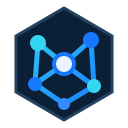

# ULTIMATE KNOWLEDGE ENGINE

  

<strong>Cyber Blue</strong> · The visual identity for the UKE knowledge ecosystem · <a href="docs/brand-system.md">Brand system</a>

**The Complete Multilingual Programming & Computer Science Knowledge System**

> One Knowledge Base. Multiple Learning Experiences. Global Knowledge.

Ultimate Knowledge Engine (UKE) is a long-term project to create a structured, multilingual knowledge and learning ecosystem for programming, computer science, software engineering, and related fields.

[فارسی](content/fa/README.md) · [Start here](START-HERE.md) · [Roadmap](docs/roadmap.md) · [Contributing](CONTRIBUTING.md)

## Mission

Build one reliable knowledge base that supports five connected experiences:

1. **Encyclopedia** — rigorous explanations of concepts, technologies, and computer-science foundations.
2. **Technical dictionary** — terminology, syntax, built-ins, APIs, errors, and cross-language comparisons.
3. **Learning academy** — roadmaps, lessons, exercises, quizzes, and projects from beginner to specialist.
4. **Interactive laboratory** — isolated code practice and visual learning tools.
5. **Knowledge engine** — multilingual discovery, prerequisite maps, relationships, and version-aware navigation.

The repository is the canonical source of truth. A future website will be generated from the same reviewed content.

## Current stage

**Foundation / v0.1.0 — initial construction.** The architecture and standards are established as a starting point. Planned features and registry entries do not imply that every lesson, translation, or application already exists.

| Dimension | Long-term target |
|---|---|
| Knowledge domains | 12 top-level domains |
| Languages and technologies | Broad registry; expandable beyond 50 |
| Content locales | Architecture ready for 20–30+ locales |
| Learning levels | Beginner, intermediate, advanced, specialist |
| Content | Markdown/MDX with structured metadata |
| Website | Generated from canonical repository content |
| Code execution | Optional isolated infrastructure, never the production web process |

See [PROJECT-STATUS.md](PROJECT-STATUS.md) and [the roadmap](docs/roadmap.md).

## Knowledge domains

| ID | Domain | Scope |
|---|---|---|
| 00 | Core & Navigation | Orientation, learning methods, project standards |
| 01 | Programming Languages | Language guides, syntax, runtimes, ecosystems |
| 02 | Computer Science | Algorithms, data structures, computation, theory |
| 03 | Software Engineering | Design, architecture, testing, maintenance |
| 04 | Web & App Development | Frontend, backend, mobile, APIs |
| 05 | AI & Data Science | Statistics, ML, deep learning, data engineering |
| 06 | Systems & Networking | Architecture, operating systems, networks |
| 07 | DevOps & Cloud | Delivery, infrastructure, containers, cloud |
| 08 | Cybersecurity | Secure development, privacy, defensive security |
| 09 | Databases | Data modelling, SQL, NoSQL, transactions |
| 10 | Mathematics | Discrete mathematics, logic, statistics |
| 11 | Projects & Research | Guided projects, case studies, research literacy |

The [domain registry](registry/domains.yaml) defines the canonical taxonomy. Each initial locale has a landing page for all 12 domains.

## Language coverage

The planned registry spans web, data, systems, enterprise, mobile, game, functional, scripting, embedded, legacy, and specialist ecosystems. Initial examples include Python, JavaScript, TypeScript, Java, C, C++, C#, Go, Rust, PHP, Ruby, Swift, Kotlin, Dart, R, Julia, SQL, Bash, PowerShell, Haskell, Elixir, Erlang, Clojure, OCaml, F#, COBOL, Fortran, Ada, and Solidity.

See [registry/languages.yaml](registry/languages.yaml). Registry inclusion means tracked scope, not a completed or reviewed guide.

## Multilingual by design

Each concept has a stable identity independent of its display language. English is the initial technical reference locale; Persian is a first-class initial locale. Other locales can be added without changing concept IDs.

The locale registry contains initial English and Persian plus 25 planned additional locales. Translation status must be explicit: missing or unreviewed text must never be presented as complete.

## Quality principles

- Accuracy is more important than volume.
- Important technical claims must be traceable to sources.
- Version-sensitive information must identify its scope.
- Code examples should be reproducible and tested where feasible.
- Translations must preserve technical meaning and teaching intent.
- Third-party material may only be reused under a compatible licence.
- Public visibility does not automatically grant copying permission.
- Security, accessibility, and maintainability are design requirements.
- Unreviewed content must be labelled honestly.

Read the [editorial policy](docs/editorial-policy.md), [source standard](docs/standards/citations-and-sources.md), and [content lifecycle](docs/standards/content-lifecycle.md).

## Repository map

- `content/` — canonical lessons and guides by locale and domain.
- `dictionary/` — terminology, concepts, syntax, built-ins, and errors.
- `learning/` — roadmaps, courses, exercises, assessments, and projects.
- `registry/` — machine-readable domains, languages, locales, and resources.
- `knowledge-graph/` — stable concept nodes and typed relationships.
- `schemas/` — validation contracts for structured content.
- `templates/` — reusable authoring templates.
- `references/` — curated external sources and learning resources.
- `docs/` — architecture, governance, standards, and roadmap.
- `apps/` — future web encyclopedia and supporting applications.
- `scripts/` — validation, indexing, and maintenance tooling.
- `tests/` — structural, content, translation, and code-example checks.

## Quick start

1. Read [START-HERE.md](START-HERE.md).
2. Review the [content model](docs/architecture/content-model.md).
3. Use a template from `templates/` for a new concept or lesson.
4. Check [CONTRIBUTING.md](CONTRIBUTING.md).
5. Submit focused changes with sources and version information.

For local foundation checks, install [requirements-dev.txt](requirements-dev.txt) and run `python scripts/validate_structure.py`.

## Licence

The project licence has not yet been selected. A public repository is not automatically public domain or open source. Until a licence is added, do not assume that repository contents may be copied, redistributed, or modified. See [LICENSE-POLICY.md](LICENSE-POLICY.md).

## Community

Use the issue templates for proposals and bug reports. Contributions should be respectful, source-backed, and reviewable. See [CODE_OF_CONDUCT.md](CODE_OF_CONDUCT.md) and [GOVERNANCE.md](GOVERNANCE.md).
